<div align="center">
  
  <h1>Canvas</h1>
  <p>A light, floating UI toolkit for Roblox Studio.</p>
</div>

Canvas isn't a docked widget. It's a small bar over the viewport that shows up when you select UI and hides when you don't. Click a tool and the bar grows into that tool's panel. Click it again, or press Esc, and it shrinks back.

Drag the header (Classic) or the **::** grip (Modern) to move it. When you let go it springs to the nearest corner or edge, and it always stays on screen. Panels open away from the edge, so a bar at the bottom opens upward.

## Tools

- **Builder Icons** lists every icon in Roblox's built-in Builder Icons font, with search and Regular or Filled styles. Click an icon to apply it to the selected TextLabels, TextButtons or TextBoxes. If none are selected, it inserts a new icon label into the selection instead. The name field shows the icon's name so you can copy it for scripts.
- **Scale ↔ Offset** converts Position, Size or both to Scale or to Offset, on X, Y or both, without moving anything. It accounts for the parent's UIPadding and any UIScale.
- **Layout** adds or removes UICorner, UIStroke, UIPadding, UIListLayout, UIGridLayout and UIAspectRatioConstraint in one click. It also sets AnchorPoint without moving the object, and has center, fill and AutomaticSize shortcuts.
- **Color & Style** sets fill, text or image, and stroke colors from swatches or a hex code. It can also copy one object's style (fill, corner, stroke and text) and paste it onto others.

Every edit can be undone with Ctrl+Z. The toolbar button turns Canvas on or off.

## Settings

The cog opens Settings:

- **Theme:** Classic (the default) follows Photon's look, with a header holding the logo, title and tab buttons, and square edges. You drag it by the header. Modern is the compact rounded island with a **::** grip.
- **Show:** only while UI is selected, or always.
- **Motion:** bouncy, smooth, or no animation.
- **Placement:** snap to corners and edges, or stay wherever you drop it.
- **Size:** 90% to 125%.
- **Tooltips:** on or off.
- **On deselect:** close the open panel when nothing is selected, or keep it open.
- **Icon size:** the size of icon labels inserted from Builder Icons.

Settings also has buttons to reset the window's position and to reset all settings.

## Development

Install [Rokit](https://github.com/rojo-rbx/rokit), then run:

```sh
rokit install
wally install
./scripts/build.bash  # builds build/Canvas.rbxm and the Studio install chunks
./scripts/test.bash   # lint and tests
./scripts/dev.bash    # rebuilds Canvas-dev.rbxm into your Plugins folder when files change
```

Dev builds put the island's state in `shared.CanvasDev`, so you can open a panel from the command bar with `shared.CanvasDev.active("icons")` or move the bar with `shared.CanvasDev.slot("TopRight")`.

`./scripts/build.bash` also writes `build/studio-install.luau`. Running it rebuilds the plugin as `workspace.Canvas`, and so does `build/studio-install-2.luau` and so on if the sources needed more than one chunk. Use it through the Studio MCP or the command bar. `build/studio-install.json` holds the same tree as JSON.

When Studio updates, run `python3 scripts/generate-builder-icons.py` to pick up new Builder Icons. It reads Studio's bundled BuilderIcons package and rewrites `src/BuilderIcons/Names.luau`.

See [RELEASING.md](RELEASING.md) for publishing steps.

## License

MIT © Twisted Signal. Lucide icons use the [ISC license](third_party/lucide-LICENSE). Builder Icons ship with Roblox Studio and are not included in this repository.
